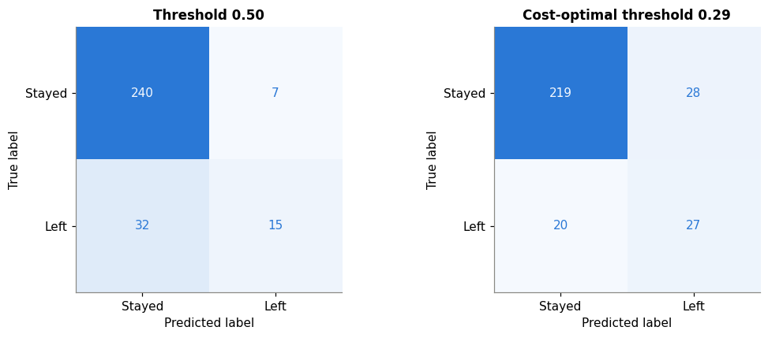
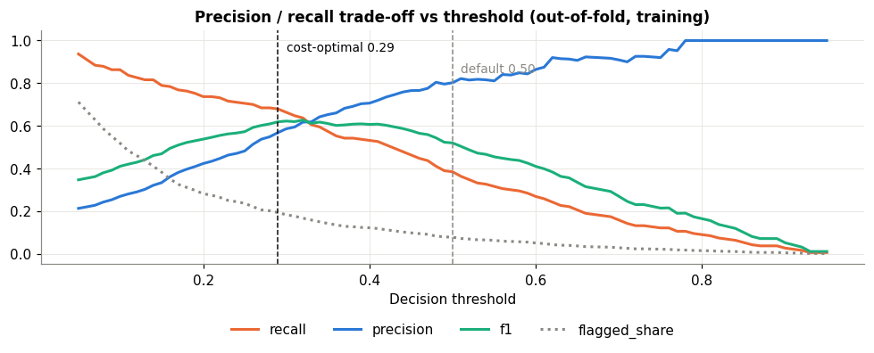
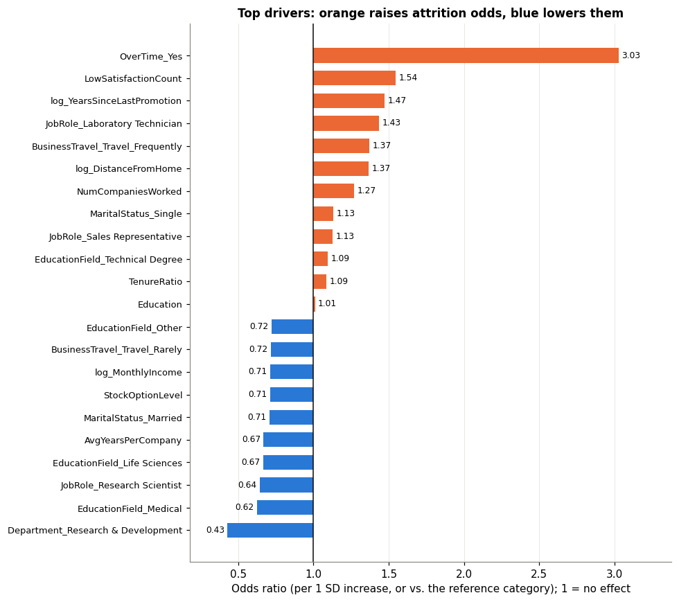

# Employee Attrition Prediction – Interpretable Logistic Regression

Predicts which employees are likely to leave, explains **why**, and sets a decision threshold based on
the business cost of missing a leaver. Built as my Advanced Apex Project-1 for the M.Sc. Data Science & AI
at BITS Pilani, where the brief limits modelling to logistic regression – so the focus is on data
preparation, feature engineering, honest evaluation and interpretation.

## Results

| | Value |
|---|---|
| Data | IBM HR Analytics, 1,470 employees, 16.1% attrition |
| Cross-validated ROC-AUC | 0.838 (baseline) → **0.854** (engineered + selected features) |
| Held-out test ROC-AUC | 0.79 (95% bootstrap CI 0.71–0.86), 294 employees |
| Recall on leavers at default 0.5 threshold | 0.32 |
| **Recall at cost-optimal 0.29 threshold** | **0.57** (precision 0.49, F1 0.53) |
| High-risk tier (score ≥ 0.29) | 19% of employees, **57% of all leavers**, 49% of them actually left |

With a 5:1 cost of missing a leaver vs a false alarm, lowering the threshold to 0.29 catches 27 of 47
test-set leavers instead of 15, at the cost of 21 extra false alarms:





## What drives attrition

Odds ratios from the final model (per 1 SD for numeric features, vs the reference category otherwise):



- **Overtime triples the odds of leaving** (OR 3.0) – the single strongest driver.
- **Low satisfaction across several surveys** and **years since last promotion** each raise the odds by about 1.5× per standard deviation.
- **Higher income, stock options, longer average tenure per company and age** lower it.
- Recommended HR actions: review overtime load, act on repeated low survey scores, and watch long gaps between promotions.

## Approach

1. **Data understanding & quality** – no missing values or duplicates; removed constant and ID columns; IQR outlier review; data dictionary.
2. **EDA** – attrition rate by every categorical/ordinal variable, distributions by outcome, correlation analysis.
3. **Feature engineering** – e.g. a count of low satisfaction scores, average years per company, tenure ratio, log transforms of skewed variables; then feature selection.
4. **Controlled experiments** (5-fold stratified CV, one change at a time):

   | Experiment | ROC-AUC | PR-AUC | Recall |
   |---|---|---|---|
   | Majority-class baseline | 0.500 | 0.162 | 0.00 |
   | Logistic regression, raw features | 0.838 | 0.652 | 0.44 |
   | … without scaling | 0.735 | 0.392 | 0.06 |
   | + engineered features | 0.853 | 0.671 | 0.47 |
   | + feature selection | **0.854** | **0.681** | 0.47 |
   | + `class_weight="balanced"` | 0.849 | 0.651 | 0.76 |

5. **Limited tuning** – grid over C, penalty and class weight; the simplest model within one standard error of the best was kept (C = 0.1, L2).
6. **Evaluation** on an untouched 20% test set, with bootstrap confidence intervals, a cost-based threshold, risk tiers and per-department results.
7. **Fairness audit** – recall and false-positive rate by gender, age band and marital status. Dropping age and marital status changes ROC-AUC only from 0.843 to 0.840, so they can be excluded if required.

## Limitations

- The test set is small (47 leavers), so test metrics have wide confidence intervals; the tuned model and the baseline are statistically indistinguishable on it.
- Recall is uneven across groups (e.g. lower for employees aged 50+), which should be reviewed before any real use.
- The dataset is fictional (created by IBM data scientists), so the drivers illustrate the method rather than any real company.

## Run it

```bash
pip install -r requirements.txt
jupyter notebook employee_attrition_prediction.ipynb
```

The notebook finds `WA_Fn-UseC_-HR-Employee-Attrition.csv` in the same folder and runs top to bottom.

**Data:** [IBM HR Analytics Employee Attrition & Performance](https://www.kaggle.com/datasets/pavansubhasht/ibm-hr-analytics-attrition-dataset) (Kaggle).

## Author

**Ayush Poojari** · [github.com/ayushpoojari3699](https://github.com/ayushpoojari3699)
